<div align="center">

<picture>
  <source media="(prefers-color-scheme: dark)" srcset="docs/images/logo-dark.png" />
  
</picture>

<br />

**One on one in a white world.**

A top-down duel shooter written in Lua with LÖVE, where faceted single-color fighters hunt each other through fog, glass and noise.

[](https://github.com/0xS4cha/kyma/actions/workflows/ci.yml)
[](https://github.com/0xS4cha/kyma/actions/workflows/build.yml)
[](LICENSE)


[**Quick start**](#quick-start) · [Download](https://github.com/0xS4cha/kyma/releases) · [Gameplay guide](docs/GAMEPLAY.md) · [Technical guide](docs/TECHNICAL.md) · [Hosting](docs/HOSTING.md) · [Report a bug](https://github.com/0xS4cha/kyma/issues)

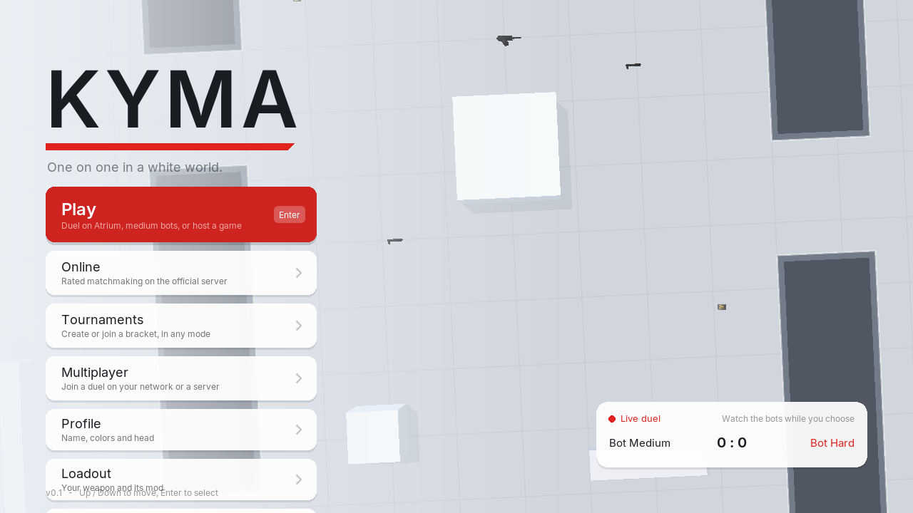

</div>

---

## Table of contents

- [Overview](#overview)
- [Features](#features)
- [Quick start](#quick-start)
- [Controls](#controls)
- [Tech stack](#tech-stack)
- [Architecture](#architecture)
- [Testing](#testing)
- [Hosting a server](#hosting-a-server)
- [Documentation](#documentation)
- [Contributing](#contributing)
- [Acknowledgements](#acknowledgements)
- [License](#license)

## Overview

Two players, one room, no minimap cheat. The camera turns with you so that where you aim is always the top of the screen, you only see what lies in your view cone, and every shot, dash and footstep gives you away. Read the room, listen, and strike first.

<div align="center">

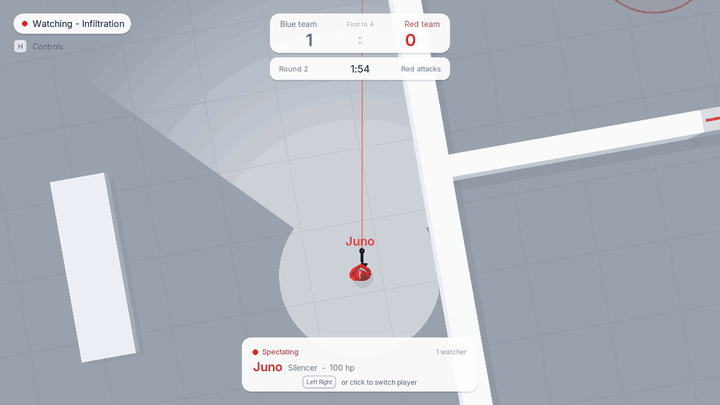

*An Infiltration round on Embassy, played by bots: the attackers smoke the terminal and hack it under fire.*

</div>

Every game is multiplayer under the hood: even a practice game runs a local server in a background thread, like Minecraft. The server is authoritative at 60 ticks per second, and the client predicts your own moves so they stay instant whatever your ping.

## Features

### Six weapons, one life at a time

| Weapon | Damage | Magazine | What makes it different |
| --- | --- | --- | --- |
| **Pistol** | 34 | 8 / 32 | Three hits, one shot per click. Everyone starts with it. |
| **Rifle** | 22 | 24 / 48 | Automatic, 10 shots per second. Waits in the middle of the map. |
| **Shotgun** | 7 × 14 | 5 / 15 | Wide spread, deadly up close. |
| **Sniper** | 100 | 4 / 8 | One shot, one kill, and the only laser others see through the fog. |
| **Silencer** | 30 | 10 / 30 | No noise, its shots only show to players who can see you. |
| **LMG** | 15 | 60 / 60 | 12 shots per second, but you move at 72% speed and can't slide. |

Out of ammo? **Throw your weapon** for 45 damage, or rush in with your fists: a **strike** stuns and knocks the opponent's gun to the floor. **Dash** through bullets, or **slide** while running and keep shooting.

<table>
<tr>
<td width="50%">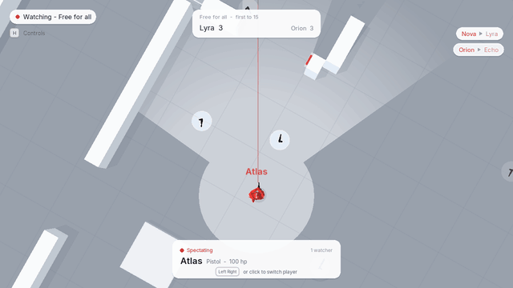<p align="center"><sub>Free for all on Warehouse: shots leave smoke trails that lead back to the shooter</sub></p></td>
<td width="50%">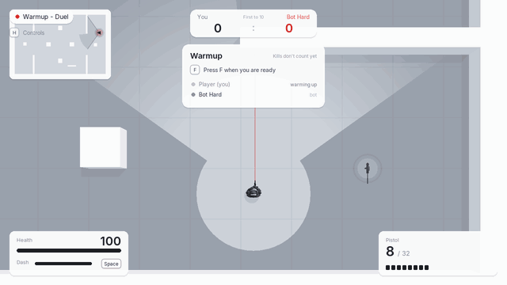<p align="center"><sub>Eliminated? The killcam replays the last two seconds from your killer's eyes</sub></p></td>
</tr>
</table>

### See little, hear everything

| System | What it gives you |
| --- | --- |
| **View cone** | You see about 110 degrees ahead, up to 380 units, and walls block the view. Everything else is greyed out. The server never sends a player you can't see, so a modified client can't reveal anyone. |
| **Noise** | Shots, dashes, running steps, thrown weapons and doors leave an echo on the floor for whoever can't see you. Hold <kbd>C</kbd> to walk quietly. |
| **Traces** | Every bullet leaves a smoke trail and a hole in the wall. Follow it back and you find the shooter. |
| **Map elements** | Doors that open as you come close, glass you see through but must break to shoot, low cover, chasms you can shoot across. |
| **Gadgets** | Smoke that blinds players, bots and the server alike, flashbangs, and decoys that fake your gunfire. |

### Five modes

| Mode | Players | Win |
| --- | --- | --- |
| **Duel** | 2 | First to 10 eliminations |
| **Free for all** | up to 6 | First to 15 |
| **Teams** | 4 against 4 | First team to 25, with shared vision |
| **Gun game** | up to 6 | Climb seven weapons, win with a punch |
| **Infiltration** | 4 against 4 | Rounds with one life: hack a terminal or hold it until the clock runs out |

<table>
<tr>
<td width="50%">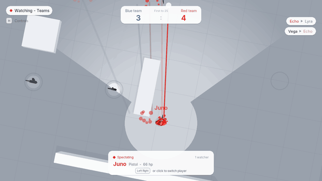<p align="center"><sub>Teams: allies in blue, enemies in red, spotted targets shared by the whole team</sub></p></td>
<td width="50%">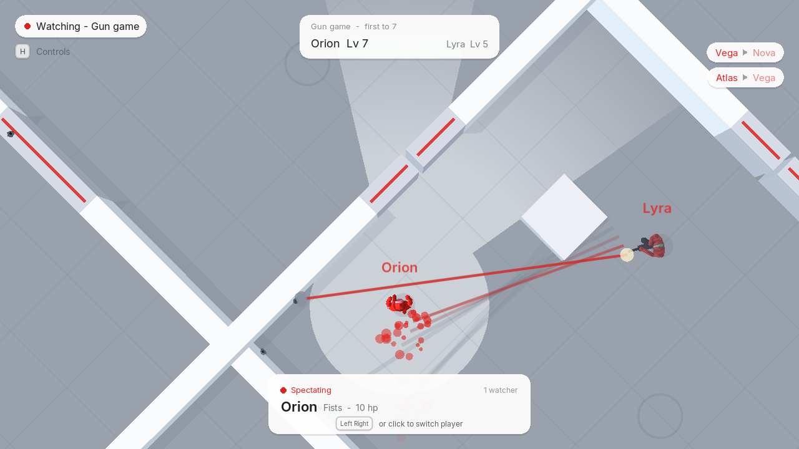<p align="center"><sub>Gun game on Bunker: every kill hands you the next weapon</sub></p></td>
</tr>
</table>

Every match opens on a **warmup**: try the weapons, press <kbd>F</kbd> when you are ready, and a countdown starts once everyone is.

### Fifteen maps

<picture>
  <source media="(prefers-color-scheme: dark)" srcset="docs/images/maps-dark.png" />
  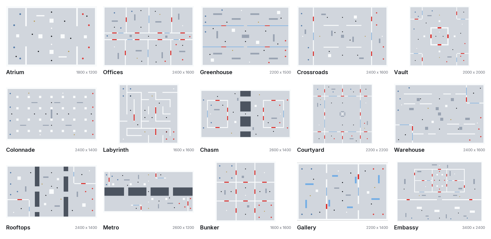
</picture>

From the open hall of **Atrium** to the glass cases of **Gallery** and the street-to-server-room raid of **Embassy**. Every map has four spawns per team, works in every mode and, except the Labyrinth, is point symmetric. Doors are drawn in red, glass in blue, spawns as blue and red dots.

### Feel

- **Hitstop**: kills, punches and big hits freeze the picture for a split second, then ease back.
- **Recoil and screen shake** tuned per weapon, with Full, Low or Off in the settings.
- **Procedural sound**: about 30 effects synthesized at startup, with no audio file, panned and faded by distance so you can hear where a fight is.
- **A live bot duel** plays behind the main menu.

### Make it yours

<table>
<tr>
<td width="50%">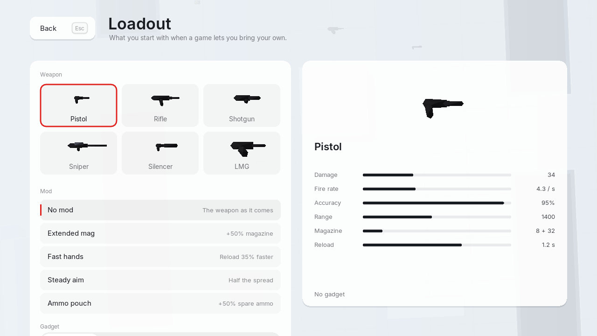<p align="center"><sub>Pick your weapon, a mod and a gadget, with live stats</sub></p></td>
<td width="50%">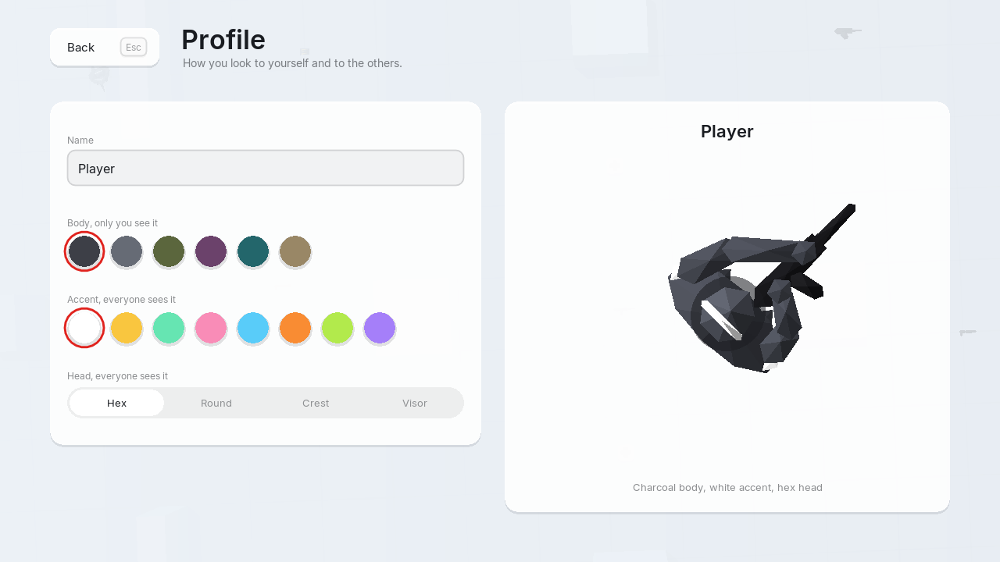<p align="center"><sub>Body color, accent and head shape, with a live preview</sub></p></td>
</tr>
<tr>
<td width="50%">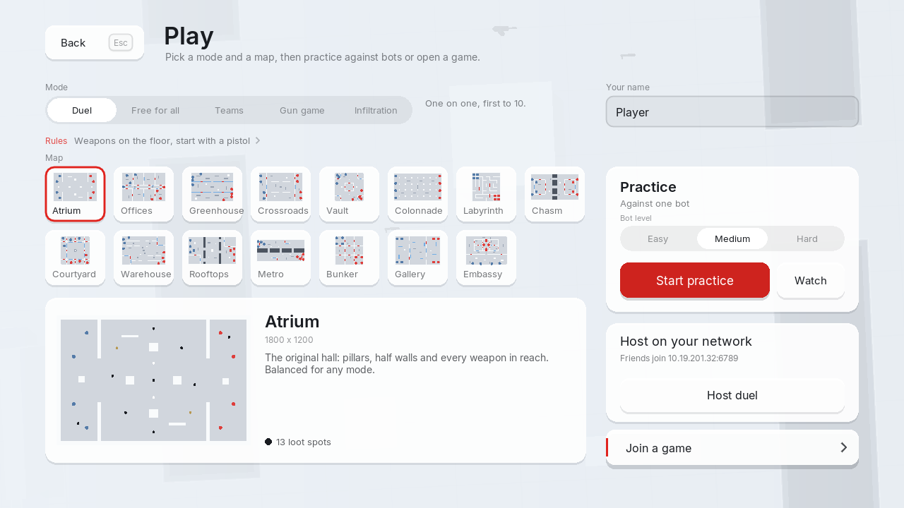<p align="center"><sub>Choose a mode, a map and the bots' level, or host the game</sub></p></td>
<td width="50%">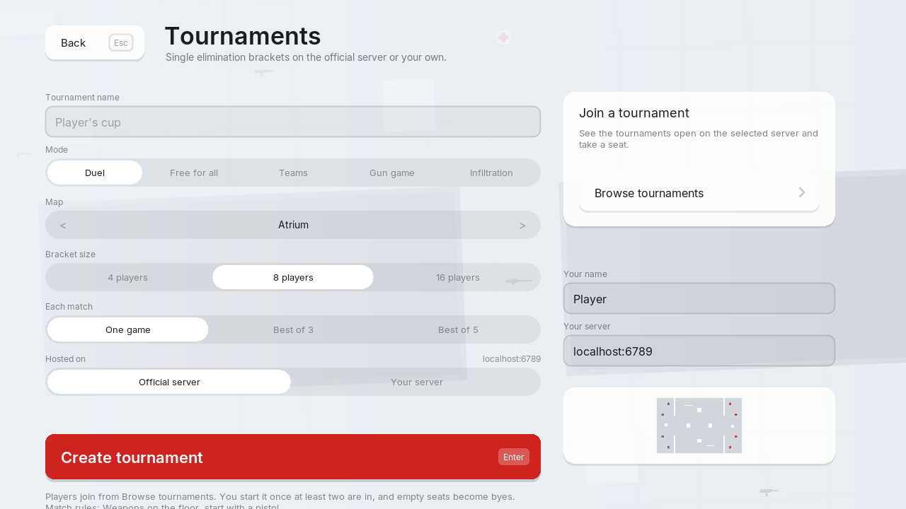<p align="center"><sub>Single-elimination tournaments of 4, 8 or 16 players</sub></p></td>
</tr>
</table>

- **Mods**: Extended mag, Fast hands, Steady aim or Ammo pouch, one per weapon, and visible on the gun for everyone.
- **Match rules**: weapons on the floor or not, start with a pistol, your own loadout or the same set for everyone.
- **Rebindable keys**, stored by position so the defaults work on QWERTY and AZERTY alike.

### Light and dark

<div align="center">

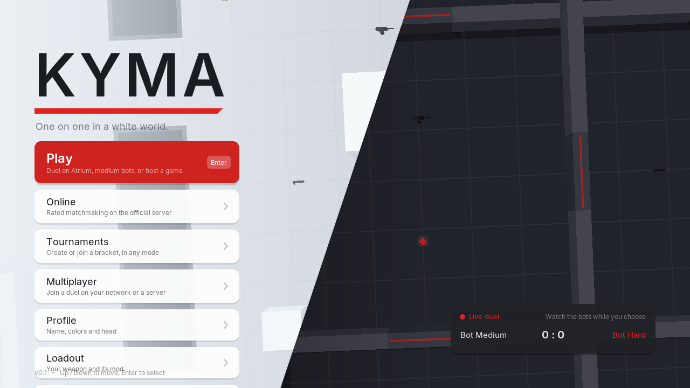

</div>

Settings > Appearance turns the whole game around, from the floor and the fog to every menu and the HUD. Enemies stay red and teammates blue.

### Multiplayer

- **Online**: rated matchmaking on the official server, grouped by rating, per mode.
- **LAN**: host from the menu, and games on your network show up by themselves.
- **Dedicated servers**: `love . --server`, a Docker image or a Pterodactyl egg.
- **Spectating**: watch any game, or fill a map with bots and watch them play.
- **Chat**, team chat, and a pause that really pauses when you practice alone.

## Quick start

### Prerequisites

- [LÖVE](https://love2d.org/) **11.5**

Or grab a ready-made build for Windows, macOS or Linux from the [releases](https://github.com/0xS4cha/kyma/releases).

### Run

```bash
git clone https://github.com/0xS4cha/kyma.git
cd kyma
love .
```

New to the game? Open **How to play** from the main menu, or jump straight into a practice game with `love . --practice medium`.

### Commands

| Command | Description |
| --- | --- |
| `love .` or `make run` | Open the main menu. |
| `love . --practice hard --mode ffa --map vault` | Practice against bots (`easy`, `medium`, `hard`) on any mode and map. |
| `love . --practice hard --watch` | Fill a game with bots and watch them. |
| `love . --host` or `make host` | Host a duel on your network (UDP 6789). |
| `love . --connect 127.0.0.1:6789 --name Bob` | Join a game. |
| `love . --server` or `make server` | Run a headless dedicated server. |
| `love . --test` or `make test` | Run the test suite. |
| `make build` | Package Windows, macOS and Linux builds into `dist/`. |

Every other flag is listed in the [technical guide](docs/TECHNICAL.md#command-line).

## Controls

| Input | Action |
| --- | --- |
| <kbd>W</kbd> <kbd>A</kbd> <kbd>S</kbd> <kbd>D</kbd> | Move and strafe, relative to where you aim |
| <kbd>Mouse</kbd> | Turn |
| <kbd>Left click</kbd> | Fire, or strike with empty hands |
| <kbd>Space</kbd> / <kbd>Shift</kbd> / <kbd>Right click</kbd> | Dash, or slide while running |
| <kbd>C</kbd> / <kbd>Ctrl</kbd> | Walk quietly |
| <kbd>R</kbd> | Reload |
| <kbd>G</kbd> / <kbd>Middle click</kbd> | Throw your weapon |
| <kbd>E</kbd> | Pick up or swap a weapon |
| <kbd>Q</kbd> | Throw your gadget |
| <kbd>F</kbd> | Ready up during the warmup |
| <kbd>Tab</kbd> | Scoreboard |
| <kbd>Enter</kbd> | Chat |
| <kbd>H</kbd> / <kbd>Esc</kbd> | Controls reminder / pause menu |

Every key can be changed in Settings > Key bindings.

<div align="center">

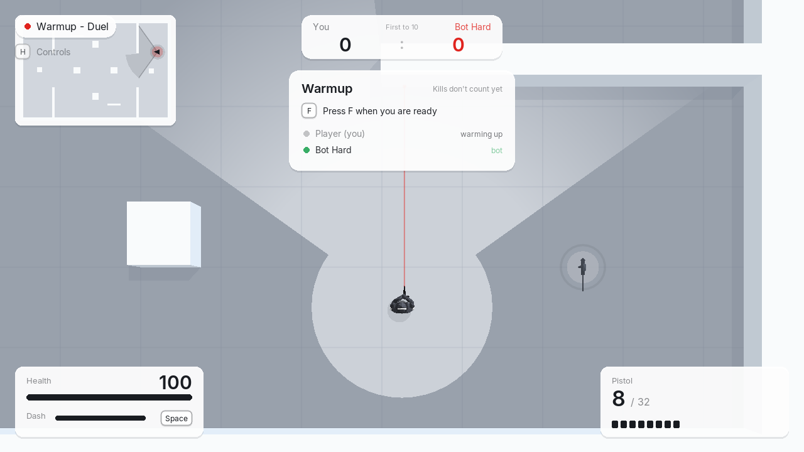

*The HUD: health and dash on the left, weapon and ammo on the right, the map with your position in the corner.*

</div>

## Tech stack

| Layer | Technologies |
| --- | --- |
| **Engine** | [LÖVE](https://love2d.org/) 11.5 and LuaJIT |
| **Simulation** | Fixed 60 ticks per second, shared by client and server: movement, weapons, vision, gadgets, rounds |
| **Network** | ENet, a custom binary protocol, client-side prediction, interpolation and lag-compensated hits |
| **Rendering** | Faceted characters, stencil view cones, a shader-graded killcam, two themes |
| **Audio** | A synthesizer that renders every sound at startup |
| **Tooling** | Headless test suite, GitHub Actions, LuaLS, Docker, Pterodactyl, love-build |

## Architecture

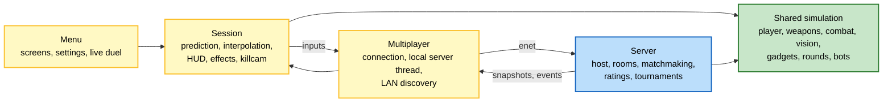

| Path | Role |
| --- | --- |
| `main.lua` | LÖVE callbacks, command-line flags, dispatch to modules |
| `src/core/` | Engine helpers: class, logger, turning camera, random, args, threads |
| `src/game/` | Simulation shared by client and server: arena, player, weapons, combat, vision, bots |
| `src/maps/` | One file per map, built with `builder.lua` |
| `src/net/` | Binary codec, protocol, input validation |
| `src/server/` | Authoritative server: transport, host, duel and practice rooms |
| `src/ui/` | UI kit shared by the menu and the HUD: cards, buttons, fields, themes, minimap |
| `src/modules/` | Game modules, auto-loaded and registered with `GM.Modules:Register(name, priority)` |
| `src/config/` | Window, game, weapon, gadget and feel settings |
| `tests/` | Headless test suites run by `tests/runner.lua` |

The networking model, the camera and the full project structure are explained in the [technical guide](docs/TECHNICAL.md).

## Testing

```bash
love . --test        # or: make test
```

The suite runs headless in about 12 seconds: 200 cases over 38 files, from the binary protocol, prediction and lag compensation to every mode, every map's reachability, bots, the killcam and the Pterodactyl egg. The CI runs it on every push, then boots the menu, a practice game and an autoplay session under `xvfb`.

## Hosting a server

```bash
love . --server --name "My server" --motd "Hello there"
docker compose up -d --build
```

A dedicated server runs rated matchmaking and tournaments, and keeps ratings across restarts. Docker, Pterodactyl and every option are covered in the [hosting guide](docs/HOSTING.md).

## Documentation

| Guide | Content |
| --- | --- |
| [**Gameplay guide**](docs/GAMEPLAY.md) | Every mechanic in detail: combat, noise, modes, maps, loadouts, feel, menus. |
| [**Technical guide**](docs/TECHNICAL.md) | Networking, camera, command line and project structure. |
| [**Hosting guide**](docs/HOSTING.md) | Dedicated servers, Docker, Pterodactyl, matchmaking and tournaments. |

## Contributing

Issues and pull requests are welcome. Run `make test` before opening a pull request.

## Acknowledgements

- [LÖVE](https://love2d.org/) and [LuaJIT](https://luajit.org/)
- [Athena](https://github.com/0xS4cha/athena), the sister project the sound synthesizer comes from
- [Inter](https://rsms.me/inter/) by Rasmus Andersson, under the SIL Open Font License (`assets/fonts/OFL.txt`)

## License

Released under the [MIT License](LICENSE).
