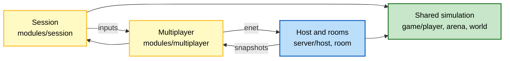

# Technical guide

[Back to the README](../README.md)

## Overview

Kyma is a top-down duel shooter. Every game runs on a server, even solo: `love .` starts a local server in a background thread and connects to it, like Minecraft, so solo, LAN and online play share one code path.



## Networking

The server is authoritative and simulates at 60 ticks per second. Athena used a lockstep, which suits a strategy game but adds the full network delay to every action; a duel needs instant movement, so Kyma uses client-side prediction instead.

- **Channels**: enet channel 0 is reliable (`hello`, `welcome`, `queue`, `joined`, `room`, `error`), channel 1 is unreliable and sequenced (`input`, `state`): a late packet is useless once a newer one exists.
- **Inputs**: every client tick produces a command `{ s, f, r, a, d }`: sequence number, forward and strafe axes (-1, 0, 1), the facing angle packed on 16 bits and the dash flag (1 on the tick the dash key was pressed). Each packet carries the last 4 commands so a lost packet costs nothing. The server drops commands it already has (`src/net/inputs.lua` validates them).
- **Input budget**: a player earns one input per tick and can bank up to 4 to absorb jitter. Sending inputs faster does not move faster, and the queue is capped at 12.
- **Snapshots**: every 2 ticks (30 Hz) each client receives `state { t, k, p }`: the server tick, the last input sequence the server applied for this client, and for every player the position, angle, velocity and dash state (remaining dash ticks, cooldown ticks, dash direction), which the client needs to replay its pending inputs exactly.
- **Prediction and reconciliation**: the client moves its own player immediately with the same `Player.step` the server runs (`src/game/player.lua`). When a snapshot arrives it takes the server position, drops the acknowledged inputs and replays the pending ones. The visual difference is absorbed over a few frames instead of snapping.
- **Interpolation**: the opponent is drawn 6 ticks (100 ms) in the past, between the two snapshots around that time, so it moves smoothly despite the 30 Hz updates.
- **Matchmaking**: `queue` puts the client in the oldest room waiting for an opponent, or opens a new one. A room holds 2 players and closes when empty.

## Camera

`src/core/camera.lua` follows the local player at 68% of the screen height and turns the world so the facing direction always points up. The mouse (captured in relative mode) or the arrow keys turn the player; movement is relative to the facing direction.

## Command line

| Flag | Description |
| --- | --- |
| *(none)* | Solo: start a local server on 127.0.0.1 and join it |
| `--host` | Start the local server on the network (UDP 6789) so another player can join |
| `--connect host:port` | Join a remote or LAN server |
| `--name Alice` | Player name |
| `--server --port 6789` | Run a headless dedicated server |
| `--autoplay` | Move and turn automatically (tests) |
| `--frames N` | Quit after N frames, printing any error |
| `--screenshot shot.png` | With `--frames`, save the last frame in the LÖVE save directory |
| `--test` | Run the test suites |

Play a duel on one machine:

```bash
love . --host --name Alice
love . --connect 127.0.0.1:6789 --name Bob
```

## Dedicated server

```bash
love . --server --port 6789
docker build -t kyma-server . && docker run -p 6789:6789/udp kyma-server
```

`make standalone-server` packages the same server as a Linux AppImage.

## Project structure

```
├─ main.lua                 # LÖVE callbacks, CLI flags, --server and --test switches
├─ conf.lua
├─ server/                  # Entry point used to package the dedicated server
└─ src/
   ├─ config/               # Window and gameplay constants
   ├─ core/                 # Class, camera, logger, args, env, random, hash
   ├─ game/                 # Simulation shared by client and server: arena, player, world
   ├─ net/                  # Binary codec, protocol, net config, input validation
   ├─ server/               # Authoritative server: enet transport, host, rooms, thread, runner
   └─ modules/
      ├─ index.lua          # Module loader and callback dispatch
      ├─ multiplayer/       # Connection and local server thread
      └─ session/           # Prediction, interpolation, input, camera and drawing
```
