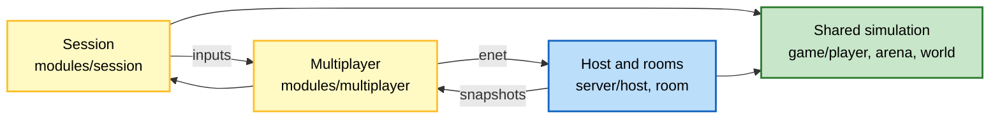

# Technical guide

[Back to the README](../README.md)

## Overview

Kyma is a top-down duel shooter. Every game runs on a server, even solo: `love .` starts a local server in a background thread and connects to it, like Minecraft, so solo, LAN and online play share one code path.



## Networking

The server is authoritative and simulates at 60 ticks per second. Athena used a lockstep, which suits a strategy game but adds the full network delay to every action; a duel needs instant movement, so Kyma uses client-side prediction instead.

- **Channels**: enet channel 0 is reliable (`hello`, `welcome`, `queue`, `joined`, `room`, `error`), channel 1 is unreliable and sequenced (`input`, `state`): a late packet is useless once a newer one exists.
- **Inputs**: every client tick produces a command `{ s, f, r, a, d, b, l, t, e, k, v }`: sequence number, forward and strafe axes (-1, 0, 1), the facing angle packed on 16 bits, then the action flags (dash, trigger held, reload, throw, pick up, quiet walk) and, while firing, `v`, the server tick of the opponent position the player was looking at. Each packet carries the last 4 commands so a lost packet costs nothing. The server drops commands it already has (`src/net/inputs.lua` validates them).
- **Input budget**: a player earns one input per tick and can bank up to 4 to absorb jitter. Sending inputs faster does not move faster, and the queue is capped at 12.
- **Snapshots**: every 2 ticks (30 Hz) each client receives `state { t, k, p, d, sc, s }`: the server tick, the last input sequence the server applied for this client, the players it can see (position, angle, velocity, dash, health, death timer, weapon; plus ammo, reserve, reload and cooldowns for its own player, which it needs to replay its pending inputs exactly), the weapons on the floor or in flight, the score and the shots fired since the previous snapshot (drawn as tracers; `h` tells whether the bullet stopped on a wall, a player or nothing, for impacts and hit sprays).
- **Events**: hits (`hit { a, t, d }`) and eliminations (`kill { k, v }`) are sent on the reliable channel.
- **Shooting**: firing, ammo, reload and the fire rate run in the shared simulation (`src/game/weapons.lua`), so the client fires and counts ammo instantly. The server decides the hits (`src/game/combat.lua`): it keeps the player positions of the last 64 ticks and checks the bullet against where the target was at the tick `v` the shooter saw, capped at 20 ticks (333 ms) in the past. Shotgun spread comes from a hash of the player and the input sequence, so client tracers and server pellets match.
- **Vision**: the server only sends an opponent to a client when that client can see it (`src/game/vision.lua`: line of sight past the walls, inside the view cone or close by), with a slightly wider cone than the one drawn so players don't pop in. A modified client cannot reveal a hidden opponent. The client draws the same cone with a stencil and greys out the rest.
- **Modes** (`Config.modes`): a `World` has a mode with a player cap, a score limit and a teams flag. `World:enemies` drives friendly fire, visibility (allies always sent), noise (no echo from allies), bot targets and kills; `World:spawnPoint` picks the spawn farthest from living enemies, restricted to the team's spawns. Reaching the limit sets `world.over` and an `over` event; damage stops, and `restart` resets scores, floor items and spawns 8 s later. Rooms take `{ mode, map, bot }`, balance teams, and fill every free slot with bots in practice; matchmaking only joins rooms of the requested mode (any mode when none is given).
- **Sound** (`src/modules/audio/`): the synthesizer from Athena renders every recipe of `sounds.lua` into a mono buffer at startup (about 30 sounds, under 100 ms), with a few voices each and per-sound cooldowns. `GM.Audio:PlayAt(name, x, y)` scales the gain with the distance to the local player and pans with the on-screen position. The session triggers sounds from local prediction (shots, strikes, dash, slide, reload, dry fire), from snapshots (other players' shots with their weapon `g`, heard noises, doors and glass changing state, pickups, ammo, healing) and from events (hits, kills, melee, level, start, match end); the menu plays hover, click and the wipe. Volume is the `volume` setting.
- **Key bindings** (`src/input/keybinds.lua`): actions with up to two scancodes each, saved to `kyma_keybinds.txt`; `Keys.down` and `Keys.is` drive movement and actions in the session, `Keys.label` every key hint in the HUD. Binding a key already used removes it from the other action; Escape is reserved for the menu.
- **Chat**: `chat { text, team }` is cleaned (`Text.clean`, 120 characters), rate limited (5 messages in 5 s) and broadcast by the room, or only to the sender's teammates in team modes. The last 30 public messages are sent as `chatlog` to joining players. While typing the client sends neutral inputs.
- **Killcam**: the server keeps 180 ticks of positions, angles and weapons plus a shot log; on a kill, `Combat.killcam` packs the last 120 ticks of the killer and the victim (every other tick, rounded positions) and the killer's shots, and the room sends it to the victim only (`killcam`). The client replays it at 1.18x during the respawn delay with the killer's camera and view cone.
- **Warmup**: rooms create their `World` with a warmup; `World:lobby` moves from `warmup` to `countdown` when every non-bot player is ready (`ready` message, `World:setReady`) and at least two players are in, back to `warmup` if someone unreadies, and to `playing` through `restart("playing")` when the countdown ends (`start` event). Kills only score while `playing`; after a match `restart("warmup")` clears the ready flags. Snapshots carry the phase (`ph`) and the ready slots (`rd`).
- **Gun game**: a mode with a `ladder`; `World:loadout` gives each player the weapon of their level (score + 1) with 999 reserve on spawn, respawn and after each kill, and sends a `level` event. Drops, throws, pickups, melee disarms and weapon pads are disabled in ladder modes; reaching the score limit (the length of the ladder) with a fists kill ends the match.
- **Shared vision**: in team modes `World:visible` also returns true when a living teammate sees the enemy (`World:sees`), with a second value telling it is shared; the snapshot marks such entries `sp = 1` and the client draws them as spotted targets.
- **Map elements**: `Arena` holds static `walls` and `cover`, and dynamic `doors` and `glass` copied per instance. `Arena:each(mode)` decides what blocks: `move` (walls, closed doors, intact glass, cover), `bullet` (no cover), `vision` (walls and closed doors only) and `nav` (like move, doors count as open). The server opens doors near living players and regrows glass (`updateDoors`, `updateGlass`), and sends both as compact strings (`dd`, `gg`) in each snapshot; the client applies them so prediction collides with the same doors.
- **Maps** (`src/maps/`): one file per map built with `src/maps/builder.lua` (walls with door, glass, cover or open gaps, boxes, spawns, loot, and `mirror` for point symmetry that turns team 1 spawns into team 2). `src/maps/index.lua` lists them; rooms and clients build their `Arena` from the map id sent in `joined`. `tests/maps_test.lua` checks every map: spawns and loot clear of obstacles, four spawns per team, doors not buried in walls, and every spawn and loot spot reachable by the bots' pathfinding. `src/ui/minimap.lua` draws a map preview.
- **Bot navigation** (`src/game/nav.lua`): a 30-unit grid built once per map from walls, cover and glass (doors passable), A* with a binary heap, and steering that skips path points as soon as the straight line is clear.
- **Weapon traits**: `silent` weapons make no shot noise and their shots carry `q = 1`, which the room only forwards to the shooter and to players who can see them (`World:shows`). `exposed` weapons (sniper) put their holder in the snapshot's `l` list for opponents who can't see them, so the client draws the laser through the fog. A `speed` factor (LMG) scales movement in the shared simulation, which also keeps the carrier under the slide threshold.
- **Melee**: with no weapon, `Weapons.update` turns a new trigger press into a strike (cooldown `melee.cooldown`), predicted like a shot. The server resolves it with the same rewind as bullets (`Combat.melee`: reach, arc, line of sight), damages, stuns (`stun` ticks slow the player and block firing, dashing and pickups) and drops the target's weapon 60 units ahead. A `melee` event drives the punch animation of other players.
- **Slide**: in the shared `Player.step`, a dash input while running forward (`Player.running`: forward key, not quiet, at 80% of max speed) starts a slide along the current velocity that decelerates from 760 to 140 units/s over 28 ticks. `Player.evading` (dash, or the first 8 slide ticks) is what the lag-compensated hit test and thrown weapons check; it is stored in the position history.
- **Noise**: the server records noises (`Combat.noise`: shot, dash, step, throw, clank, each with a radius in `Config.noise`) and sends each client, in its snapshot, the ones it can hear: within the radius and made by a player it cannot see (`World:hears`). Footsteps are emitted every 20 ticks while moving faster than 110 units/s, unless the input has the quiet flag `k`, which also slows the player in the shared simulation.
- **Weapons on the floor**: thrown weapons fly, bounce off walls and slow down on the server; they hurt the first opponent they touch and then land. Loot pads (`arena.loot`) respawn their weapon 10 seconds after it is taken. Ammo packs are items of kind `ammo` (sent with `k = 0`): eliminations drop one, two pads spawn them, and `Combat.refill` gives an armed player one magazine when they walk over one, capped at `reserve * ammoReserveCap`. `E` and the unarmed auto pickup ignore them. Throwing and picking up are not predicted: they show up after one round trip.
- **Prediction and reconciliation**: the client moves its own player immediately with the same `Player.step` the server runs (`src/game/player.lua`). When a snapshot arrives it takes the server position, drops the acknowledged inputs and replays the pending ones. The visual difference is absorbed over a few frames instead of snapping.
- **Interpolation**: the opponent is drawn 6 ticks (100 ms) in the past, between the two snapshots around that time, so it moves smoothly despite the 30 Hz updates.
- **Matchmaking**: `queue` puts the client in the oldest room waiting for an opponent, or opens a new one. A room holds 2 players and closes when empty. `queue { bot = "easy"|"medium"|"hard" }` opens a private practice room instead: the server adds a bot in the second slot and queues one bot command per tick before stepping the world.
- **Bots** (`src/game/bot.lua`): they only use what a player could know (line of sight through `Vision.sees`, last seen position), turn at a limited rate, wait a reaction time and aim with an error set per level in `Config.bots`, pick up a weapon when unarmed, roam between loot pads, unstick themselves and dash when hit. The menu runs two of them in a local `World` for the live duel behind the menu.
- **LAN discovery**: a host announces its duel every second with a UDP broadcast on port 6788 (`src/modules/multiplayer/lan.lua`); the Multiplayer screen listens and lists the duels it hears about.

## Camera

`src/core/camera.lua` follows the local player at 68% of the screen height and turns the world so the facing direction always points up. The mouse (captured in relative mode) or the arrow keys turn the player; movement is relative to the facing direction.

## Command line

| Flag | Description |
| --- | --- |
| *(none)* | Open the main menu |
| `--screen play` | Open the menu on a screen: `play`, `multiplayer`, `settings`, `howto` |
| `--practice hard` | Start a practice game against bots (`easy`, `medium`, `hard`) |
| `--mode ffa` | Mode for `--practice`, `--host` or `--play`: `duel`, `ffa`, `teams` |
| `--map vault` | Map for `--practice`, `--host` or `--play` (see `src/maps/index.lua`) |
| `--play` | Start a local server on 127.0.0.1, join it and wait for an opponent |
| `--host` | Start the local server on the network (UDP 6789) so another player can join |
| `--connect host:port` | Join a remote or LAN server |
| `--name Alice` | Player name |
| `--server --port 6789` | Run a headless dedicated server |
| `--autoplay` | Move and turn automatically (tests) |
| `--frames N` | Quit after N frames, printing any error |
| `--screenshot shot.png` | With `--frames`, save the last frame in the LÖVE save directory |
| `--test` | Run the test suites |

Play a duel on one machine:

```bash
love . --host --name Alice
love . --connect 127.0.0.1:6789 --name Bob
```

## Dedicated server

```bash
love . --server --port 6789
docker build -t kyma-server . && docker run -p 6789:6789/udp kyma-server
```

`make standalone-server` packages the same server as a Linux AppImage.

## Project structure

```
├─ main.lua                 # LÖVE callbacks, CLI flags, --server and --test switches
├─ conf.lua
├─ server/                  # Entry point used to package the dedicated server
└─ src/
   ├─ config/               # Window, gameplay and weapon constants
   ├─ core/                 # Class, camera, logger, args, env, random, hash
   ├─ game/                 # Simulation shared by client and server: arena, player, weapons, vision,
   │                        # world, combat (hits, rewind, items, loot pads, deaths)
   ├─ net/                  # Binary codec, protocol, net config, input validation
   ├─ server/               # Authoritative server: enet transport, host, rooms, thread, runner
   └─ modules/
      ├─ index.lua          # Module loader and callback dispatch
      ├─ menu/              # Main menu: screens, transitions, settings, live bot duel, pause
      ├─ multiplayer/       # Connection, local server thread, LAN discovery
      └─ session/           # Prediction, interpolation, input, camera, effects and drawing
```
